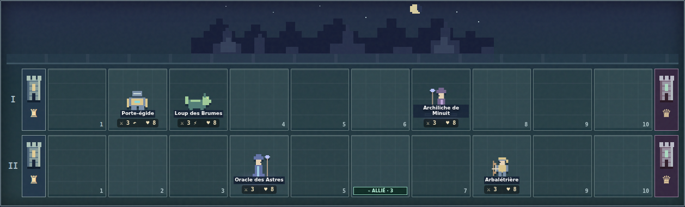

# V2.11 — arène fantasy lo-fi, proposition sur branche séparée

## Périmètre demandé

Base : `main` V2.10, commit `a59dd3a91a9c1c7101dee8e2048d9d3fff2e0dc5`. L'utilisateur a demandé le même nombre de cases et de lignes que le plateau de référence, et une ambiance fantasy lo-fi. La branche `feat/arena-fantasy-lofi` propose cette évolution ; **pas de fusion automatique**.

Le nombre historique de lignes dépend du mode. Références consultées le 12 octobre 2026 :

- [Kings & Legends, compte rendu de parties](https://gameogre.com/kings-legends-first-impressions/) : deux lignes normales, trois dans certaines rencontres spéciales.
- [Archive du premier niveau](https://kingsandlegends-archive.fandom.com/wiki/Silver_Heron_Ridge) : deux lignes, avec une variante de tutoriel à une ligne.
- [Documentation communautaire Rise of Mythos](https://www.readonly.wiki/w/Rise%20of%20Mythos) : dix cases par ligne, deux en 1v1, trois en 2v2, quatre pour les boss de groupe. Cette édition apparentée complète les références ; les formats ne sont pas universels pour chaque mission historique.
- [Captures Kings and Legends](https://www.browsergames.de/kings-and-legends) : organisation horizontale, couronnes aux extrémités, troupes sur le champ de bataille.

Dans notre jeu **solo**, la transposition choisie est : dix cases réelles sur chaque ligne ; deux lignes pour les missions de difficulté 1–2, trois à difficulté ≥3, quatre pour les boss. Le tutoriel à une ligne et les véritables modes multijoueurs ne sont pas ajoutés. Les couronnes sont hors des dix cases. Les règles existantes d'invocation à une extrémité et de deux cartes par tour sont conservées.

## Règles et sauvegardes

- Colonne 1 : entrée alliée ; colonne 10 : entrée adverse. Couronnes en 0/11. Une seule créature par case, mêmes portées et vitesses que la V2.10.
- Contrôles V2.9 et huit compétences V2.8 valides dans toutes les lignes et colonnes : silence borné, téléportation à colonne identique, Garde, Vol, Charge, Riposte, Concorde, barrières et soins.
- Pièges runiques au centre (5/6 avec replis), pièges de créature devant elle, entre les deux cases d'entrée ; limite, effets et durée conservés. L'IA utilise la distance publique pour éviter un piège qui expirerait avant l'arrivée d'une menace.
- Un combat sauvegardé en **3×5 reste intégralement en 3×5**, avec positions, durées, pièges et tours intacts. Aucun agrandissement en cours de partie. Les nouveaux combats passent à 2/3/4×10.
- Aucun changement de clé `couronnes_arcanes_v1` / `couronnes_arcanes_bataille_v1`, aucune réinitialisation du profil. Les VFX sont exclus de la sérialisation. Les formats incohérents sont refusés sans effacement du profil.
- Catalogue inchangé : 76 cartes. Aucun changement des prix, PV de missions, statistiques, délais, récompenses ou decks ennemis.

## Art et architecture

`src/engine/board.js` centralise les dimensions à partir du tableau réel et la sélection du format à la création. Moteur, contrôles, IA, compétences, stockage, rendu et simulateur le partagent ; aucune dépendance inverse.

`src/ui/arena-art.js` dessine un décor nocturne de ruines, une lune et huit silhouettes originales en SVG sur une grille de pixels : combattant, archer, lourd, mage, soigneur, mort-vivant, bête et volant. Variantes de couleurs par ordre, orientation adverse et animations CSS existantes. Ces silhouettes sont partagées, sans prétendre à 76 personnages uniques ni à des animations dessinées image par image. Les douze portraits peints de collection sont conservés.

Sur téléphone, les cases gardent une taille tactile et le plateau défile horizontalement ; la position de défilement est rétablie après les actions. Le déploiement est accessible au clavier. Le réglage d'animations et la préférence de mouvement réduit s'appliquent aux sprites, effets et brume.

## Vérifications exécutées localement

- `npm test` : **210 réussis, 0 échoué**, dont 37 nouveaux tests de géométrie, capacités aux colonnes 6–10, contrôle, IA, stockage et art embarqué.
- `npm run test:parity` : **60 scénarios V2.4 identiques**, explicitement joués sur la géométrie historique. La référence est inchangée. Les scénarios historiques à positions fixes utilisent un constructeur de fixture 3×5 ; leurs assertions sont conservées.
- `npm run build` et `npm run build:test` : 22 modules ; export de production sans accès internes, illustrations et SVG intégrés. `JOUER.html` synchronisé.
- `browser_arena_v211.py` : 2/3/4×10, vrai déploiement au clavier, sorts, sauvegarde/reprise de chaque format, défilement, absence de débordement de page, anciennes sauvegardes et impact de projectile sur la vraie couronne. Bureau 1366×900, portrait 390×844, paysage 844×390.
- Entrée modulaire HTTP également vérifiée : imports ES, déploiement, tour et reprise.
- `browser_class_skills_v28.py`, `browser_battle_control_v29.py` : compétences, six cartes de contrôle, reprise historique, export hors ligne et stockage réel, bureau et téléphone simulé.
- Les résultats GitHub Actions doivent être consultés sur la tête publiée de la PR. Un succès local ne prouve pas un succès distant.

## Comparaison du rythme

`npm run arena-balance` : mêmes profils fictifs, decks, adversaires et graines pour chaque paire ; trois collections × quatre classes × quatre compositions × huit rencontres × huit graines × deux géométries = **6 144 combats**. Deux passes exigées strictement identiques : **12 288 exécutions**. Données complètes : `ARENA_BENCHMARK_V2_11.json`.

| Classe | Victoires 3×5 | Victoires 2/3/4×10 | Tours moyens anciens | Tours moyens nouveaux |
|---|---:|---:|---:|---:|
| Gardien | 56,8 % | 58,5 % | 13,44 | 19,89 |
| Arcaniste | 59,9 % | 65,0 % | 12,39 | 19,58 |
| Rôdeur | 58,9 % | 61,3 % | 12,37 | 19,40 |
| Clerc | 59,6 % | 58,2 % | 12,61 | 18,74 |

Chaque taux porte sur 768 combats par classe et géométrie. Total : 1 806/3 072 victoires sur l'ancien format, 1 866/3 072 sur le nouveau. Durée moyenne : **12,7 → 19,4 tours**. Zéro état invalide, zéro combat inachevé. Maximum 35 tours ; un des 6 144 combats atteint ce seuil. L'attrition existante intervient plus souvent (572/3 072 contre 2 110/3 072).

`npm run control-balance` passe également : **20 480 scénarios** avec nouveaux plateaux, quatre classes, quatre compositions, deux niveaux et cinq variantes ; maximum 35 tours, états de silence/pièges valides et compétences réellement utilisées.

## Limites et suite

Le plateau plus long modifie volontairement le tempo : davantage de préparation et de combats sous attrition. Les bots sont heuristiques et les huit rencontres comparatives ne représentent pas toute une campagne humaine. Ces taux ne prouvent ni l'équilibrage final ni la difficulté vécue par un joueur ; aucun avantage caché n'a été ajouté pour les améliorer.

Pas de téléphone physique testé, de coop, de PvP, de nouvelle musique ni de portraits uniques par carte. Une revue humaine du rendu et du rythme reste utile avant intégration. Prochaine amélioration cohérente : mesurer l'attrition et la durée sur ce plateau avec le retour du joueur, puis développer le donjon tactique prévu pour V3.0.
